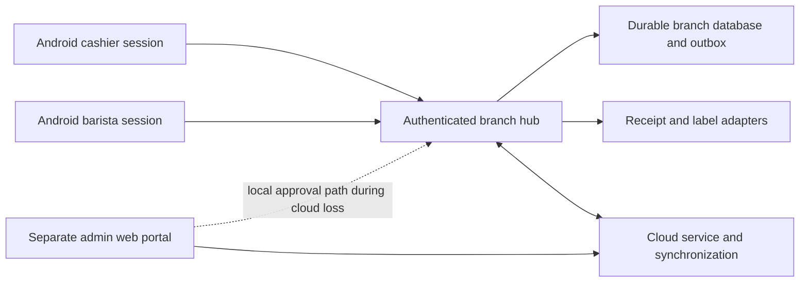

# KAPE DOZ execution plan

Date: 4 November 2026, Asia/Manila. Audience: development and design team.

## Delivery target

Complete the single-branch software system and pass the software acceptance checks from sign-in to service completion for cashier, barista and authorized owner/manager accounts. Physical tablet, LAN and printer acceptance is tracked separately. Physical hub power, repairs and café manual operating procedures are outside this project.

The verification goal is active. This document defines execution; it does not certify the system as complete. A passing sample test cannot satisfy a requirement that depends on services or devices that have not been implemented.

### Confirmed decisions

- Staff delivery: Flutter Android application for phones and tablets, tablet counter layout first.
- Admin delivery: separate responsive web portal for tablets and computers, confirmed in this planning session.
- Access: one staff role per employee; individual staff PINs; separate stronger admin sign-in; server-enforced permissions.
- Service: dine-in may reach the bar before payment; takeout waits for full confirmed payment; sent-order amendments notify the barista; restricted actions require manager approval.
- Printing and recovery: optional receipt button on the payment screen after full payment; service continues with a healthy local hub during cloud or printer problems; pending work stays visible.

### Source precedence

1. Apply the latest explicit user decisions.
2. Follow the editable [wireframes](../wireframes/kape-doz.pen) and current [handoff](<Kape Doz handoff.md>).
3. Consult [BACKEND_ARCHITECTURE.md](../BACKEND_ARCHITECTURE.md) for accepted business rules.
4. Consult [PRODUCT.md](../PRODUCT.md) and sample client answers for implementation context.
5. Resolve conflicting legacy statements in an architecture decision record before implementing the affected behavior.

The current approved wireframes are grayscale. Legacy warm-theme, PWA, shared-role and automatic-receipt wording does not override later decisions. Unfinished orders appear as Order # in the product. The project files are currently outside a Git repository; use a source hash manifest for evidence until version control is established.

## Current implementation baseline

| Existing path | Observed capability | Limit |
| --- | --- | --- |
| `mobile/lib/domain/cafe_engine.dart` | Sample orders, split payments, routing, reservation, ready consumption and waste | In-memory business model; no authenticated durable branch service. |
| `mobile/lib/data/development_store.dart` | Whole-state local persistence | SharedPreferences development store; not a production ledger. |
| `mobile/lib/main.dart` | Local staff UI, working orders, tables, payment and station slice | Sample staff switching; no authoritative identity or integrated printer. |
| `mobile/lib/admin/admin_app.dart`, `mobile/lib/staff_wireframe/staff_app.dart` | Illustrative screen previews | Preview navigation does not enforce access or execute real admin workflows. |
| `mobile/test/` | Domain/widget regression coverage | No integrated service journey suite at present. |

Fresh baseline results and known gaps are recorded in [VERIFICATION STATUS.md](<VERIFICATION STATUS.md>). All acceptance cases are in [VERIFICATION MATRIX.md](<VERIFICATION MATRIX.md>).

## Architecture to implement

The local approval path must be explicitly implemented and authorized; the cloud portal must not imply that a pending offline request has been approved. A portal may use an enrolled local mode if the agreed deployment supports it. Otherwise cloud-dependent admin work remains visibly unavailable. Confirm the mode before promising offline approvals.

### Proposed project areas

| Area | Target path | Responsibility |
| --- | --- | --- |
| Staff app | Existing `mobile/` | Cashier/barista UI, typed API client, permitted cache and recoverable commands. |
| Shared services | Proposed `services/` | Modular branch/cloud handlers, authorization, database migrations, outbox, reporting and adapter workers. |
| Admin portal | Proposed `admin/` | Authenticated owner/manager web UI with granular permissions. |
| Contracts | Proposed `contracts/` | Versioned API schemas, event types, money/unit definitions and fixtures. |
| Verification | Existing `mobile/test/`; proposed `mobile/integration_test/`, `services/tests/`, `admin/tests/` | Repeatable software evidence tied to matrix case IDs. |

Proposed backend default: one modular TypeScript service codebase with branch and cloud entrypoints, SQLite for transactional branch storage and PostgreSQL for cloud storage; responsive React/TypeScript admin portal. These are planning defaults, not installed or verified components. Confirm host compatibility and record the runtime decision before scaffolding. Preserve the Flutter staff app and migrate its business behavior through tested contracts rather than duplicating incompatible rules.

## Milestone 1. Freeze the contract and complete missing designs

Dependency: none. Risk: requirements drift. Output: one versioned product contract.

1. Reconcile the eight flow maps in `wireframes/kape-doz.pen`.
2. Specify missing screen states in the same design file, including refreshed PNG exports in `WIREFRAME + FLOW/WIREFRAMES/`.
3. Record runtime, hosting and unresolved policy decisions in proposed `docs/ARCHITECTURE_DECISIONS.md`.
4. Define independent order, payment, kitchen, print, approval and sync states in proposed `contracts/`.
5. Map every required behavior to a case in `VERIFICATION MATRIX.md`.

Missing design coverage includes customer identification/redemption, refund tender allocation and outcomes, stock receiving/counts, device/session recovery, queue overflow/handover, import results, backup/restore, and pending/failed/unknown actions. Each relevant screen needs loading, empty, successful, error and denied-access behavior. Confirm exact operational choices without inventing client facts.

**Pass gate:** each workflow has an actor, permitted action, entry state, exit state, failure branch, screen and verification case. No unresolved rule is disguised as an accepted default. Hardware-only details can remain explicitly pending where software adapters can be tested independently.

## Milestone 2. Build trusted identity and durable persistence

Dependency: Milestone 1 contracts. Risk: financial corruption or unauthorized access. Output: tested branch/cloud foundation.

1. Create sequential migrations in proposed `services/migrations/`.
2. Implement authenticated identity and object authorization in proposed `services/src/identity/`.
3. Implement atomic command handling in proposed `services/src/commands/`.
4. Replace production use of `DevelopmentStore` through proposed `mobile/lib/data/repositories/`.
5. Verify persistence and access boundaries through proposed `services/tests/integration/`.

Persist orders, tenders, drawer/shift events, recipe versions, inventory and loyalty movements, approvals, print jobs and synchronization state. Use immutable command IDs and entity versions; commit business changes and their outbox records together. Retried requests return the accepted result. Money uses centavos; quantities use exact base units and explicit conversions.

The application must distinguish a locally pending command from a hub-acknowledged transaction. Role changes, timeout, revocation and offline access expiry must be enforced by the authority. Staff responses and caches must exclude purchase costs, profit, OPEX, expected cash and variance. The admin query parameter in the preview is not an authorization mechanism.

**Pass gate:** denied actions leave no changes; acknowledged writes survive process restart; duplicate and concurrent commands have one business effect; staff sessions cannot fetch restricted data.

### Staff restart recovery

1. Introduce versioned enrollment and command repositories under `mobile/lib/data/` with Android Keystore-backed encrypted persistence.
2. Replace the in-memory callback in `mobile/lib/connected/staff_app.dart` with one immutable serializable command journal persisted before transmission.
3. Reconcile the journal through `GET /api/v1/commands/:commandId` after the original actor signs in on the same device and hub.
4. Preserve unresolved commands through logout, expiry, denied access, unreadable storage and failed journal clearing.
5. Verify restart, response loss, wrong-account access, duplicate retry and corruption with injected storage and real-hub transport tests.

Schema 10 adds terminal rejection receipts with rolled-back business effects. Schema 11 adds persistent hub identity. The admin portal saves pending commands in encrypted IndexedDB, verifies the original account and hub after reload, and protects the journal across concurrent tabs. Cloud sync ordering and backup/restore remain separate recovery gates. See [verification status](<VERIFICATION STATUS.md>) for the tested journeys.

Enrollment is saved after staff authentication confirms the device. PINs and session tokens stay in memory. A point-in-time unrecorded lookup retains the original command ID and payload for exact retry. The web preview needs an explicit memory-only adapter until secure browser persistence is designed. Native backup configuration must account for encrypted state whose key cannot be restored. Physical Keystore checks remain on the separate device-validation list.

## Milestone 3. Deliver a complete café service loop

Dependency: Milestone 2. Risk: duplicate or missing service events. Output: one integrated shift across separate clients.

1. Implement role-specific sign-in and assigned drawer opening.
2. Integrate cashier order entry with the authoritative service.
3. Integrate verified tenders with optional same-screen receipt printing.
4. Integrate barista preparation with ready consumption and amendments.
5. Integrate blind shift submission with manager review.

Keep payment status separate from kitchen status. Dine-in explicitly sends before payment, or releases once at settlement if paid first. Takeout waits for full confirmation. A seventh order stays reachable beyond the six visible station cards. Recall, handover and changes to prepared items need explicit states; none may silently repeat consumption.

Fix current printing drift before claiming this milestone: `main.dart` defaults a printer as connected and permits simulated printed status; `cafe_engine.dart` creates an automatic payment-slip job. Replace those assumptions with adapter-backed status and the approved optional button. The software print tests use a controllable adapter; they cannot prove physical output. External GCash/card payments remain manually verified records, not gateway charges initiated by this system.

**Pass gate:** a cashier signs in, opens a shift, submits dine-in and takeout orders, collects split tenders, optionally requests printing, receives barista progress and submits a blind count; the manager approves or requests recount. Separate sessions and durable services must be involved. No duplicate release, tender or consumption occurs on replay.

### Sent-order amendments

The approved handoff requires the station to see changes to a sent order. F02-03 covers notification, stale preparation actions and disposition. F03-04 covers the approval boundary. X02 connects both paths to verified takeout settlement.

1. Specify immutable amendment records against the saved order version and stable line numbers. Preserve original recipe, price and tender evidence and all existing refund references.
2. Add persistent tests for amendment/Ready races, replay, wrong role/branch, unchanged orders after denial and one reservation effect per accepted change.
3. Implement cashier submission and manager decisions where required. Use authoritative pricing for changed items. A price-changing correction after payment goes through manager-approved cancellation or refund followed by a new order. Preserve the original settlement and tender history.
4. Display the changed lines at the barista station and record disposition when preparation was affected. A superseded version cannot be marked Ready. Already-consumed quantities remain in the ledger; stock for a genuine remake must be accounted for separately.
5. Rehearse sent dine-in and settled takeout across independent clients. Reconcile amendments, reservations, consumption, payments and any refunds against SQLite, including denial and stale paths.

The current hub tracks preparation at order level. A line change must never infer that a drink's ingredients were unused or fully consumed from that state alone. Preserve the initial kitchen release and label record so amendments do not create duplicate tickets.

## Milestone 4. Complete administration and exceptional paths

Dependency: Milestones 2–3. Risk: incorrect valuation, authorization or reconciliation. Output: all eight flows implemented.

1. Implement recipes and inventory operations in proposed `services/src/inventory/` and `admin/`.
2. Integrate the implemented refund allocation and payout contracts with item eligibility, loyalty reconciliation and the remaining exception paths.
3. Implement customer and loyalty operations in proposed `services/src/customers/` and `services/src/loyalty/`.
4. Implement reporting, settings, migration and restore workflows in proposed `admin/` and `services/src/` modules.
5. Integrate synchronization and print-job recovery in proposed `services/src/sync/` and `services/src/printing/`.

Receiving records packs, conversions and cost. Physical counts preserve concurrent movements. Alerts remain active after acknowledgment until resolved. Costs and recipe versions are historical snapshots. Track paid-but-not-ready costs as estimated or reserved. The first admin portal includes operating expenses and estimated operating profit. Recurring costs are allocated across covered calendar days, and one-time expenses are recognized on their effective date. See the [operating expense contract](../contracts/operating-expenses.md) for exact centavo allocation.

Record the verified settlement instant to attribute sales to the correct Asia/Manila business date. Reconcile settled sales and refunds with historical ingredient valuation before estimating gross profit. Deduct the ingredient cost of recorded waste and espresso dial-in automatically as a separate waste cost. Deduct entered operating expenses with explicit period coverage before estimating operating profit. Surface incomplete or stale inputs and leave the result unavailable when the required records cannot support it.

Approvals bind the requested action, order version, amount and reason. Refunds remain within original tender limits and preserve completed and unknown legs. Loyalty redemption requires both manager approval and cloud authorization; pending offline earnings are not immediately redeemable. Imports validate and preview before commit, with a deterministic repeat-import policy. Software backup tests restore actual persistent data in an isolated environment.

**Pass gate:** required admin operations mutate authoritative records and reconcile with the staff workflows. Failed, stale and uncertain operations remain visible. Retries do not repeat revenue, cash, stock or points effects.

For catalog availability, the user selected replacement before an unreleased order containing a newly disabled item continues. Keep a separate availability version from recipe versions. Recheck availability at creation, release and a sent amendment that adds or increases a disabled product. Preserve already-dispatched preparation and all payment records. A pending external payment confirmed after disablement still needs an accurate recorded outcome and manager reconciliation. See [ADR 008](../docs/ARCHITECTURE_DECISIONS.md#adr-008-disabled-item-on-an-unreleased-order).

### Physical stock counts (F04-03)

The user confirmed that an approved positive variance updates stock quantity and the manager confirms its cost separately. The hub updates the recorded on-hand quantity when it accepts the adjustment. Inventory shows the cost as pending until the manager records a confirmation. Historical movement costs stay intact. The user also confirmed a separate stock-loss deduction from estimated operating profit for approved shortages. Unknown loss costs keep that estimate unavailable.

1. Add service tests for snapshot conflicts, concurrent consumption and receipts, duplicate approval, negative stock, exact units, and branch and role boundaries.
2. Capture the ingredient, unit, on-hand quantity and stock version when an authorized admin starts a count. Require a fresh count if a movement changes that version before the observation is submitted.
3. Post the approved difference between the observed and snapshot quantities to the live stock balance in one hub transaction. Preserve intervening movements and reservations. Require a reason and keep prior counts and decisions available for review.
4. Present cost confirmation as a separate authorized action for a positive adjustment. Record the confirmed cost and its evidence against the adjustment. Flag valuation affected by missing cost and preserve the original costs of earlier receipts, waste and sales.
5. Rehearse the count and cost confirmation in the Inventory workspace. Reconcile both actions against SQLite and verify that exact retries create one quantity adjustment and one cost confirmation.

## Milestone 5. Verify the whole system and package a candidate

Dependency: Milestones 1–4. Risk: confusing a demo result with acceptance. Output: software acceptance report and tested artifacts.

1. Run analyzers and regression suites.
2. Execute every required matrix case against integrated services.
3. Inject process, network, concurrency and adapter failures.
4. Verify mobile layouts and admin responsiveness.
5. Record candidate build hashes and acceptance evidence.

Run the named agent lifecycle from `AGENTS.md` per implementation slice: planner; TDD guide; implementation with bounded repair if needed; silent-failure and security audit; evaluator. Do not add unit tests for this documentation change. Future meaningful behavior tests precede the relevant implementation. Browser verification stays with the primary agent using the local Playwright skill.

Software acceptance requires an Android build and emulator/native integration exercise, Flutter tests, service/database integration tests, admin tests and cross-role journeys. Admin browser checks use `helpers.resolveTargetUrl()` and 375px, 768px and 1280px widths under `.agents/rules/UI_Always.md`. Flutter layout tests additionally inspect RenderFlex exceptions, keyboard visibility, reachable actions and touch targets. Browser previews and mocks are separately labeled.

**Pass gate:** every required software case has current evidence; no release-blocking data loss, false success, permission failure, financial mismatch or duplicate effect remains. Unresolved required business decisions must be resolved or explicitly deferred by the user. Actual tablet/printer/network checks stay on their own list and do not acquire an assumed pass.

## Per-slice execution loop

1. Select an unverified matrix case.
2. Write a behavioral acceptance test.
3. Implement the smallest integrated change.
4. Run the relevant checks.
5. Record the evidence or next blocking decision.

Re-run affected role journeys when shared state, permissions or ledgers change. Run the whole integrated matrix at milestone and candidate boundaries. If the same fix fails three times, follow the workspace circuit breaker: stop that repair, return to its last working state and report the invalid assumption plus one diagnostic choice. Do not call a goal complete because a phase is slow or a budget ends.

## Completion and estimates

The work covers five milestones and eight workflow families. A reliable calendar estimate needs the Milestone 1 decision record, actual missing-screen inventory and measured delivery of the first integrated slice. Do not promise a perfect system or a fixed date from wireframe count. Completion is determined by the linked evidence gates.

The goal is completed only after all required software gates pass. Physical equipment checks and external business-policy sign-off remain explicitly described in the candidate report. See [VERIFICATION STATUS.md](<VERIFICATION STATUS.md>) for the current goal state and next action.
